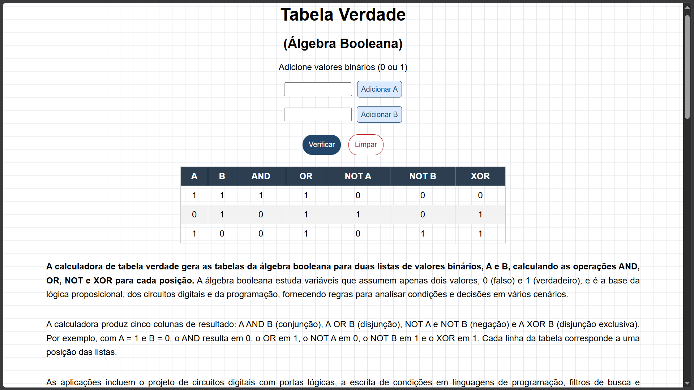

# Tabela Verdade (Álgebra Booleana)

Calculadora web que gera tabelas verdade a partir de listas de valores binários.
Feita com HTML, CSS e JavaScript puro.

🔗 **Site:** [[link do GitHub Pages](https://pablosweb.github.io/tabela-verdade-booleana/)]

## O que faz
- Você informa valores 0 e 1 para as listas A e B.
- O site monta a tabela com AND, OR, NOT A, NOT B e XOR.
- Valida campo vazio, valores diferentes de 0 e 1 e listas de tamanhos diferentes.
- Botão "Limpar" para começar um novo conjunto.
- Enter adiciona o valor, além do clique.

## Como usar
1. Digite 0 ou 1 no campo A e clique em "Adicionar A" (ou aperte Enter).
2. Repita para o campo B, com a mesma quantidade de valores.
3. Clique em "Verificar" para gerar a tabela.

## Tecnologias
HTML, CSS e JavaScript (DOM, eventos, operadores bitwise).

## O que aprendi
- Criar tabelas dinamicamente com o DOM.
- Operadores bitwise (&, |, ^): troquei 4 blocos de if repetidos por
  uma linha por coluna.
- Validar entradas e mostrar mensagens de erro e de sucesso.
- Adicionar evento para a tecla Enter.

## Como rodar localmente
Baixe o repositório e abra o index.html no navegador. Não precisa instalar nada.

## Próximos passos
- Deixar o layout mais responsivo.
- [outras ideias, como NAND e NOR]

## Autor
Pablo Ribeiro | [LinkedIn](https://linkedin.com/in/pablo-ribeiro-3794b1379)
